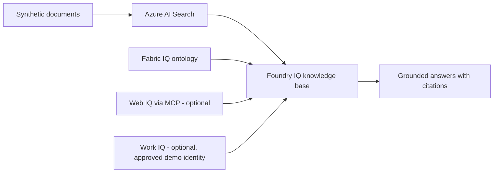

<div align="center">

# Agent-Ready Knowledge with Foundry IQ

### A repeatable Microsoft demo for grounded answers across enterprise data

[](https://learn.microsoft.com/azure/ai-foundry/)
[](https://learn.microsoft.com/azure/search/)
[](https://www.python.org/)

Prepare an Azure and Fabric demo environment, then show how Foundry IQ grounds answers in
enterprise documents, structured operational data, web results, and approved workplace context.

**For Microsoft employees presenting to customers. Customers do not need to clone, deploy, or
operate this repository.**

</div>

> [!IMPORTANT]
> This public repository is designed for Microsoft employees to deliver customer demos. Customers
> are the audience, not the operators of this repo. Use a Microsoft-controlled demo tenant,
> synthetic data, and demo identities. Never use customer content or a personal employee mailbox.
> Treat everything committed here as publicly visible.

## Start a Demo

| Need | Start here |
|:-----|:-----------|
| Rehearse the story without cloud access | [Open the browser walkthrough](demos/foundry-iq-agent-ready-knowledge/walkthrough/index.html) and its [presenter guide](demos/foundry-iq-agent-ready-knowledge/walkthrough/README.md) |
| Provision and run the live demo | Follow the [demo environment setup](DEMO_SETUP.md), then run the notebooks in sequence |
| Understand the architecture and demo package | Read the [demo overview](demos/foundry-iq-agent-ready-knowledge/README.md) |

The self-contained walkthrough is for presentation and rehearsal. It is not a recording of a live
Azure environment. The technical demo uses the resources and notebooks listed below.

## Demo Flow



| Part | Demo | Requirement |
|:----:|:-----|:------------|
| **1** | Ground answers in sample HR, benefits, and file content | Azure AI Search and Foundry model deployments |
| **2** | Add current web grounding through MCP | Approved Web IQ access |
| **3** | Retrieve structured product information through a Fabric ontology | Microsoft Fabric |
| **4** | Add workplace context from Work IQ | Approved synthetic/demo-tenant Microsoft 365 content |
| **5** | Combine Fabric IQ and Work IQ in one answer | Parts 3 and 4 |

Parts 1 and 3 are the core Azure+Fabric demo path. Parts 2, 4, and 5 are optional and require
separate tenant capabilities. Work IQ is not seeded or provisioned by this repository. Do not
sign in with an employee's real mailbox or a customer's identity to demonstrate it.

## Provisioning and Cost

The [demo environment setup](DEMO_SETUP.md) uses Azure Developer CLI (`azd`) and Bicep to provision
Azure AI Search, a Microsoft Foundry project with model deployments, and Fabric capacity and
workspace content. The deployment creates billable resources in the selected Microsoft demo
tenant.

- Review required permissions, tenant eligibility, quota, and regions before running `azd up`.
- The setup writes endpoint and key values to a local `.env` file. It is ignored by Git. Never
  commit or share it.
- The sample deployment uses public endpoints and key-based authentication for demo convenience.
  It is not a production configuration.
- Delete resources when the demo is over. Follow the Azure and Fabric cleanup checks in
  [DEMO_SETUP.md](DEMO_SETUP.md).

## Repository Guide

| Location | Purpose |
|:---------|:--------|
| [`demos/`](demos/) | Customer-facing story, presenter guide, and reusable demo catalog |
| [`notebooks/`](notebooks/) | The five technical demo flows, recovery notebook, and pinned dependencies |
| [`infra/`](infra/) | Azure/Fabric provisioning hooks, sample-index restore, and Fabric data setup |
| [`data/`](data/) | Synthetic documents and pre-built Azure AI Search index data |
| [`DEMO_SETUP.md`](DEMO_SETUP.md) | Microsoft presenter setup, validation, troubleshooting, and cleanup |
| [`templates/demo-template/`](templates/demo-template/) | Starting point for another reusable demo |
| [`scripts/demos.py`](scripts/demos.py) | Local demo scaffold, catalog, and validation commands |

Create or validate a demo package with Python 3.10 or later:

```bash
python scripts/demos.py new my-demo --title "My Demo"
python scripts/demos.py validate
```

See [CONTRIBUTING.md](CONTRIBUTING.md) for the package conventions.

## Technology

| Layer | Technology |
|:------|:-----------|
| Knowledge and retrieval | Microsoft Foundry IQ and Azure AI Search |
| Structured business data | Microsoft Fabric IQ ontology |
| Optional external context | Web IQ through Model Context Protocol |
| Optional workplace context | Work IQ with an approved demo identity |
| Provisioning | Azure Developer CLI and Bicep |
| Demo flow | Python and Jupyter notebooks |

## Attribution and Licensing

This demo is adapted from Microsoft's **Build Agentic Knowledge Bases: Next-Level RAG with Azure
AI Search** workshop. The original content owners are [Pamela Fox](https://github.com/pamelafox),
[Matt Gotteiner](https://github.com/mattgotteiner), and
[Ayca Bas](https://github.com/aycabas). The original source and history remain available in the
[Microsoft repository](https://github.com/microsoft/Build26-LAB532-from-data-to-context-agent-ready-knowledge-with-foundry-iq).

Code is provided under the [MIT License](LICENSE). Documentation and other applicable content are
provided under the
[Creative Commons Attribution-ShareAlike 4.0 International License](LICENSE-DOCS). Original
copyright and license notices are retained.

Microsoft product names and marks are subject to
[Microsoft's Trademark and Brand Guidelines](https://www.microsoft.com/legal/intellectualproperty/trademarks/usage/general).
This demo repo is not a supported product or production reference architecture.
