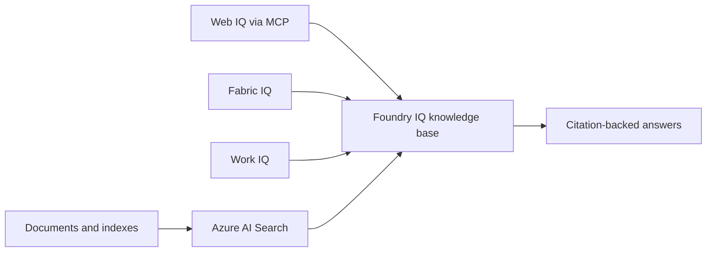

# Agent-Ready Knowledge with Foundry IQ

### A hands-on path from enterprise data to multi-source, citation-backed answers

Build an Azure AI Search knowledge base, connect it to indexed documents, Web IQ, Fabric IQ, and Work IQ, then combine those sources into one grounded retrieval experience.

**Five notebooks | Two ways to run | One progressive lab**

> [!NOTE]
> This repository is a personal adaptation of Microsoft's original [Build Agentic Knowledge Bases workshop](https://github.com/microsoft/Build26-LAB532-from-data-to-context-agent-ready-knowledge-with-foundry-iq). Credit for the original workshop and source material belongs to Microsoft and the original content owners listed below. This adaptation is independently maintained and is not an official Microsoft publication.

## Start Here

| Your environment | Best path | What you need |
|:-----------------|:----------|:--------------|
| Instructor-provided workshop environment | **[Open the guided workshop](workshop/README.md)** | Credentials and resources supplied by the instructor |
| Your own Azure subscription and tenant | **[Open the self-deployment guide](deploy_yourself.md)** | Azure CLI, Azure Developer CLI, Python 3.10+, and deployment permissions |
| Exploring the project before deployment | **[Review the notebooks](notebooks/)** | No deployment required to read the material |

> [!IMPORTANT]
> Parts 3 and 5 require Microsoft Fabric. Part 4 requires Work IQ access. Part 2 requires Web IQ access or a key supplied separately. These tenant capabilities are not included with a standard Azure subscription.

## What You Will Build

By completing the workshop, you will learn to:

- Build a multi-source knowledge base using Azure AI Search agentic retrieval
- Ground responses in indexed documents and live web content through MCP
- Add structured Fabric IQ and workplace Work IQ knowledge sources
- Combine heterogeneous sources into citation-backed answer synthesis

## The Five-Part Journey

Complete the notebooks in order. Later parts reuse the indexes and configuration created earlier.

| Part | Focus | Result | Requirement |
|:----:|:------|:-------|:------------|
| **1** | [Search indexes and files](notebooks/part1-standard-foundry-iq-kb.ipynb) | A knowledge base over HR documents, health documents, and an uploaded file | Azure AI Search and model deployments |
| **2** | [Web grounding with MCP](notebooks/part2-search-mcp-kb.ipynb) | Live web content added as a knowledge source | Web IQ access |
| **3** | [Structured data with Fabric IQ](notebooks/part3-fabric-iq-to-kb.ipynb) | Product data grounded through a Fabric ontology | Microsoft Fabric |
| **4** | [Workplace data with Work IQ](notebooks/part4-work-iq-to-kb.ipynb) | Answers grounded in content available to the signed-in user | Work IQ access |
| **5** | [Combined enterprise knowledge](notebooks/part5-work-iq-fabric-iq-to-kb.ipynb) | Work IQ and Fabric IQ combined in one knowledge base | Parts 3 and 4 |

## Quick Start

### Guided workshop

1. Sign in to the instructor-provided environment.
1. Complete the [environment setup and validation](workshop/instructions/overview.md).
1. Open the `notebooks` folder in Visual Studio Code.
1. Run Part 1, then continue through Part 5 in sequence.

### Your own environment

1. Review all [prerequisites and tenant requirements](deploy_yourself.md#prerequisites).
1. Clone the repository and create a Python virtual environment.
1. Authenticate Azure CLI and Azure Developer CLI in the same tenant.
1. Run `azd up` to provision and configure the workshop environment.
1. Follow the notebooks in sequence.
1. Run `azd down --purge --force` when finished.

The self-deployment path creates billable Azure resources. Read the full [self-deployment guide](deploy_yourself.md) before provisioning anything.

## Technology Stack

| Layer | Technology | Role in the workshop |
|:------|:-----------|:----------------|
| Knowledge and retrieval | Foundry IQ and Azure AI Search | Agentic retrieval, knowledge sources, and answer synthesis |
| Models | Azure OpenAI `gpt-5.4` and `text-embedding-3-large` | Reasoning and vector embeddings |
| External knowledge | Model Context Protocol and Web IQ | Live web grounding |
| Enterprise context | Microsoft Fabric IQ and Work IQ | Structured and workplace knowledge |
| Development | Python and Jupyter Notebooks | Interactive workshop exercises |
| Deployment | Azure Developer CLI and Bicep | Repeatable Azure provisioning |

## Repository Guide

| Location | Contents |
|:---------|:---------|
| [`notebooks/`](notebooks/) | Five exercises, dependency definitions, restore tooling, and a Copilot CLI sidequest |
| [`infra/`](infra/) | Bicep, post-provision hooks, environment setup, and data-loading automation |
| [`data/`](data/) | Sample documents and exported Azure AI Search index data |
| [`workshop/`](workshop/) | Instructor-led setup, workshop flow, and summary |
| [`deploy_yourself.md`](deploy_yourself.md) | Prerequisites, deployment, validation, troubleshooting, and cleanup |

For implementation details, supported automation, and experimental utility boundaries, see the [infrastructure guide](infra/README.md).

## Security and Cost

> [!CAUTION]
> This project is designed for learning and demonstration, not as a production reference architecture.

- Deployment creates Azure AI Search, Microsoft Foundry resources, model deployments, and optionally Microsoft Fabric capacity. Charges continue until those resources are deleted.
- Setup writes endpoints, identifiers, and API keys to a local `.env`, which is ignored by Git. Never commit or share that file.
- The sample configuration uses public endpoints and local key authentication for lab convenience. Apply your organization's network, identity, secret-management, and monitoring requirements before production use.
- Clean up with `azd down --purge --force` and follow the [cleanup verification steps](deploy_yourself.md#cleanup).

## Learn More

| Resource | Topic |
|:---------|:------|
| [Azure AI Search documentation](https://learn.microsoft.com/azure/search/) | Search concepts and service capabilities |
| [Design an index for agentic retrieval](https://learn.microsoft.com/azure/search/search-agentic-retrieval-how-to-index) | Index design for knowledge retrieval |
| [Create a knowledge base](https://learn.microsoft.com/azure/search/search-agentic-retrieval-how-to-create) | Knowledge-base configuration |
| [Answer synthesis](https://learn.microsoft.com/azure/search/search-agentic-retrieval-how-to-synthesize) | Grounded answers and citations |

## Attribution

This project is derived from Microsoft's **Build Agentic Knowledge Bases: Next-Level RAG with Azure AI Search** workshop.

Original content owners:

- [Pamela Fox](https://github.com/pamelafox)
- [Matt Gotteiner](https://github.com/mattgotteiner)
- [Ayca Bas](https://github.com/aycabas)

The original source and its commit history remain available in the [Microsoft repository](https://github.com/microsoft/Build26-LAB532-from-data-to-context-agent-ready-knowledge-with-foundry-iq). Changes in this fork include self-deployment guidance, deployment automation, and adaptations for independent use.

## License and Trademarks

Code is provided under the [MIT License](LICENSE). Documentation and other applicable content are provided under the [Creative Commons Attribution-ShareAlike 4.0 International License](LICENSE-DOCS). The original Microsoft copyright and license notices are retained.

Microsoft names, products, trademarks, and logos remain subject to [Microsoft's Trademark and Brand Guidelines](https://www.microsoft.com/legal/intellectualproperty/trademarks/usage/general). This modified repository does not imply Microsoft sponsorship or endorsement.

## Contributing

Issues and pull requests that improve clarity, portability, or the learning experience are welcome. Do not include credentials, tenant data, generated `.env` files, or notebook outputs in contributions. Participation is governed by the [Code of Conduct](CODE_OF_CONDUCT.md).
