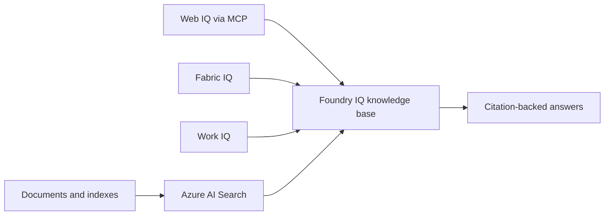

# Agent-Ready Knowledge with Foundry IQ

Build a progressive enterprise knowledge experience that grounds answers in indexed documents,
live web content, structured Fabric data, and workplace context.

| | |
|---|---|
| **Status** | ready |
| **Audience** | Microsoft presenters and customer-facing technical teams |
| **Time to demo** | About 8 minutes (walkthrough), 30-60 minutes (live technical demo) |

## Non-technical: click-through walkthrough

No install or cloud access is required. Open
[`walkthrough/index.html`](walkthrough/index.html) in a browser and use **Next / Back** or the
arrow keys to step through the story. Press **N** to show presenter notes.

Use the [`walkthrough/README.md`](walkthrough/README.md) presenter script for talking points,
timing, and common questions.

## Technical: prepare and run the demo

The notebooks and deployment scripts are the implementation used by the Microsoft presenter.
Customers are not expected to provision or operate this repository.

| What | Where |
|---|---|
| Presenter setup | [`../../DEMO_SETUP.md`](../../DEMO_SETUP.md) |
| Live demo notebooks | [`../../notebooks/`](../../notebooks/) |
| Deployment entry point | [`../../azure.yaml`](../../azure.yaml) |
| Infrastructure | [`../../infra/`](../../infra/) |
| Extension guidance | [`docs/EXTENDING.md`](docs/EXTENDING.md) |

### Quickstart

Prepare the Microsoft-controlled demo tenant and environment by following the
[demo setup runbook](../../DEMO_SETUP.md). After provisioning the full Azure+Fabric environment,
open the notebooks in VS Code and run Parts 1 and 3. The runbook also covers validation and
cleanup.

Parts 2, 4, and 5 are optional extensions. They need Web IQ access or approved, synthetic
Microsoft 365 demo content and a dedicated demo identity. Never use an employee's personal
mailbox or a customer's account in a live demonstration.

### Architecture

### Prerequisites

- A modern browser for the click-through
- Azure CLI, Azure Developer CLI, and Python 3.10 or later for the presenter
- An Azure subscription with deployment permissions
- Microsoft Fabric enabled in the demo tenant
- Web IQ access for optional Part 2
- Approved Work IQ demo content and a dedicated identity for optional Parts 4 and 5
