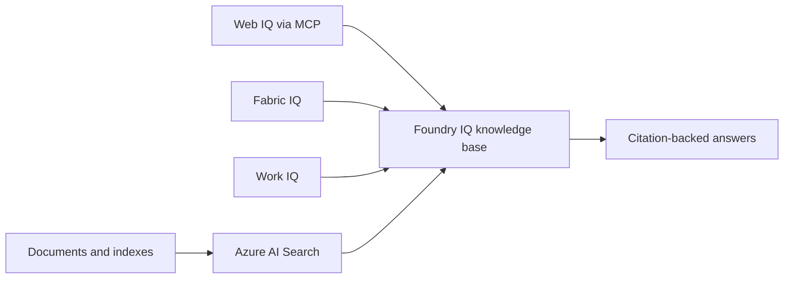

# Agent-Ready Knowledge with Foundry IQ

Build a progressive enterprise knowledge experience that grounds answers in indexed documents,
live web content, structured Fabric data, and workplace context.

| | |
|---|---|
| **Status** | ready |
| **Audience** | Business stakeholders (walkthrough), developers and architects (technical lab) |
| **Time to demo** | About 8 minutes (walkthrough), 90-150 minutes (full lab) |

## Non-technical: click-through walkthrough

No install or cloud access is required. Open
[`walkthrough/index.html`](walkthrough/index.html) in a browser and use **Next / Back** or the
arrow keys to step through the story. Press **N** to show presenter notes.

Use the [`walkthrough/README.md`](walkthrough/README.md) presenter script for talking points,
timing, and common questions.

## Technical: run, deploy, and extend

The existing workshop stays at the repository root so its deployment automation and notebook
paths remain stable.

| What | Where |
|---|---|
| Guided workshop | [`../../workshop/README.md`](../../workshop/README.md) |
| Source notebooks | [`../../notebooks/`](../../notebooks/) |
| Self-deployment | [`../../deploy_yourself.md`](../../deploy_yourself.md) |
| Deployment entry point | [`../../azure.yaml`](../../azure.yaml) |
| Infrastructure | [`../../infra/`](../../infra/) |
| Extension guidance | [`docs/EXTENDING.md`](docs/EXTENDING.md) |

### Quickstart

For an instructor-provided environment, follow the
[guided workshop](../../workshop/README.md). For your own Azure environment, review the
[prerequisites and tenant requirements](../../deploy_yourself.md#prerequisites), then run:

```bash
az login
azd auth login
azd up
```

Follow the five notebooks in order and clean up with:

```bash
azd down --purge --force
```

### Architecture



### Prerequisites

- A modern browser for the click-through
- Azure CLI, Azure Developer CLI, and Python 3.10 or later for self-deployment
- An Azure subscription with deployment permissions
- Microsoft Fabric for Parts 3 and 5
- Work IQ access for Parts 4 and 5
- Web IQ access or a separately supplied key for Part 2
